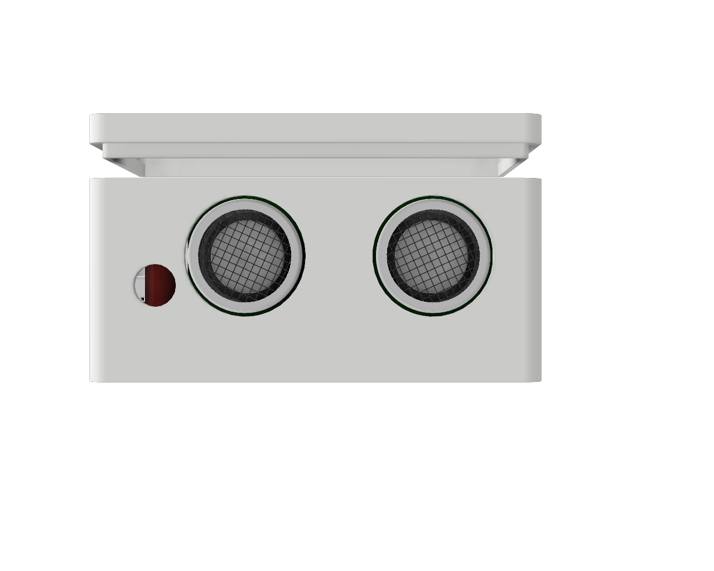
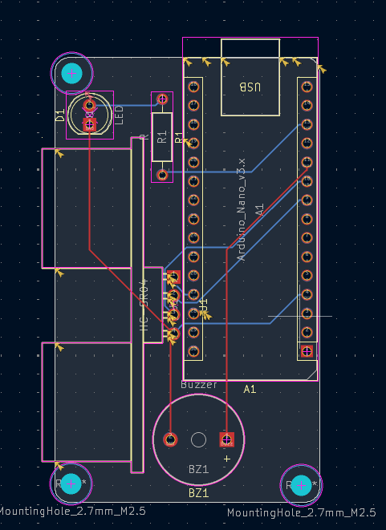
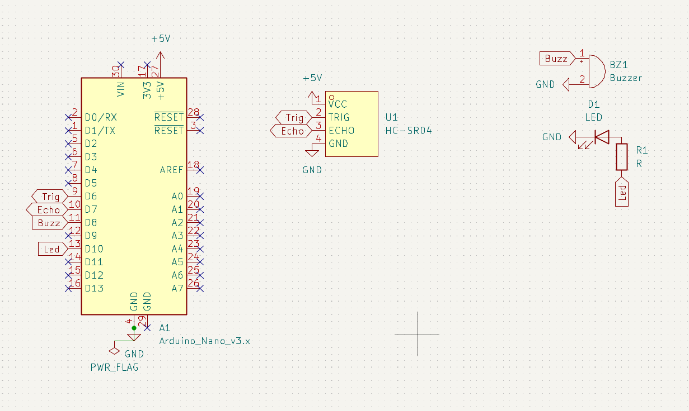
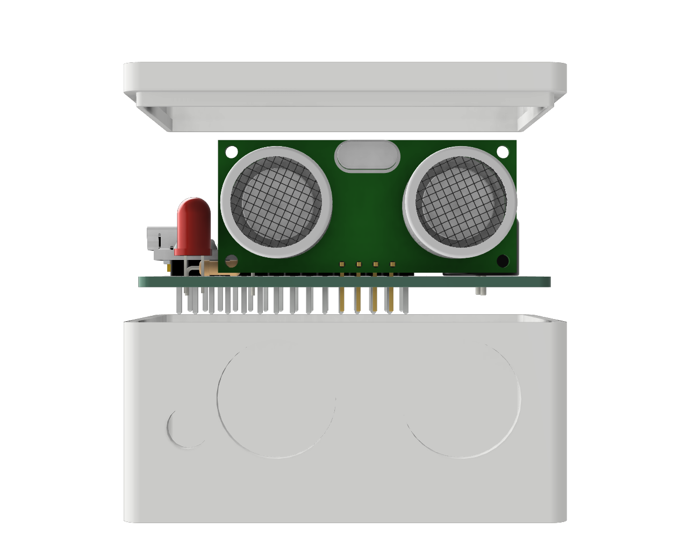
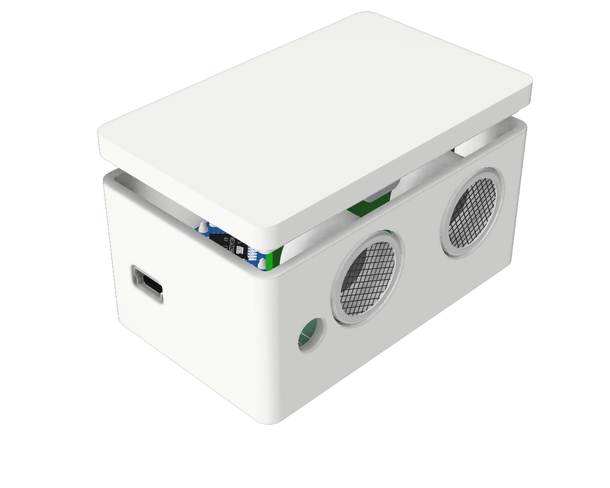

# Arms Length
A device that measures the distance between u and your mointor when u get too close to your monitor it starts buzzing

 

## Description

I made this because i have a bad habit that i get my face too close to my monitor and it has effected my eyesight,
so as a solution i made this and now device starts buzzing when i get close to the monitor and a red led lights up.
im looking to implement something that lets me show sum sort of sticker or warning  

### Screenshots
- PCB
  
- SCHEMATICS
  
- Explode view
  
- Case
  
  

## Getting Started

- Full parts list with quantities and costs: **[BOM.csv](BOM.csv)**
- Use the gerber file from Production to get Physical PCB or chnage the PCB desgin according to your need
- After Geting the PCB solder all the components
- Flash Arduino Nano with **[Arms_length.ino](Arms_length.ino)**

### Dependencies

- Download Arduino IDE
- Download **[Arms_length.ino](Arms_length.ino)**

### Executing program

- Open **[Arms_length.ino](Arms_length.ino)** in Arduino IDE
- Select Your Arduino Nano board
- Click Upload and you are done  

## License

This project is licensed under the MIT License - see the **[LICENSE](LICENSE)** file for details
